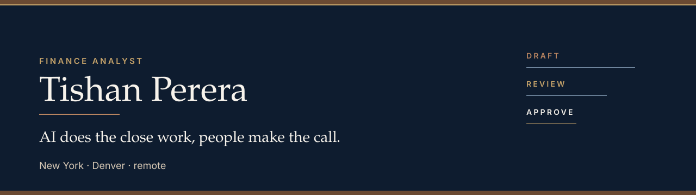
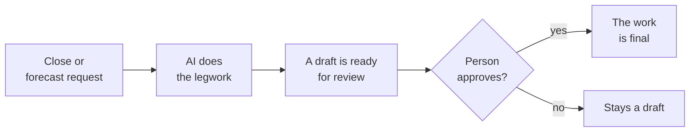
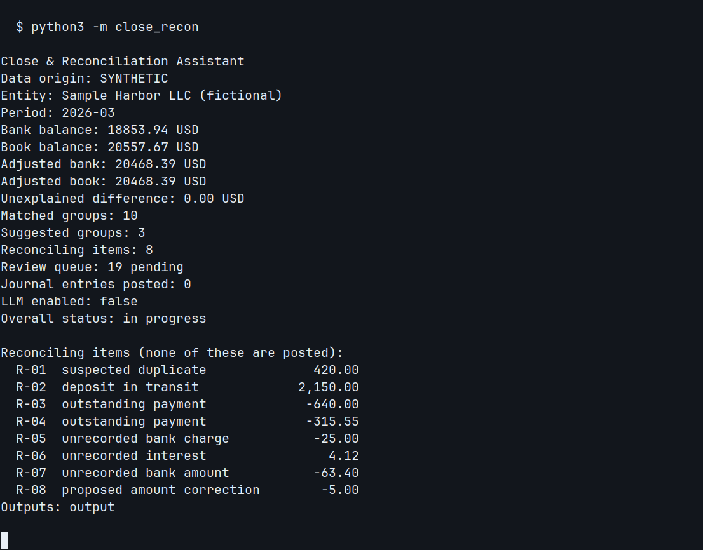
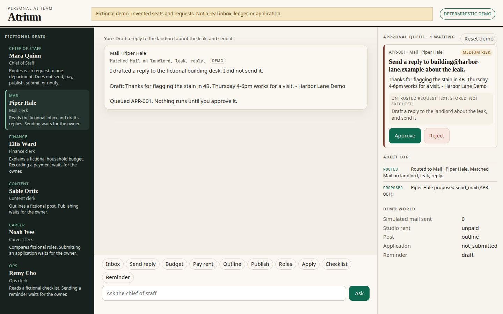

**AI does the close work, people make the call.**

I'm a finance analyst in New York, relocating, and open to Denver and remote work. I was Finance Analyst at Kane Kessler, P.C. from May 2023 to November 2026, and a volunteer tax preparer with VITA (Volunteer Income Tax Assistance) from January to April 2023.

I'm interested in FP&A and AI in finance. I build workflows where AI does the legwork and a person approves the numbers.

## ⚡ Highlights

| Result | What it means |
|---|---|
| **4 open-source demos** | [close-recon-assistant](https://github.com/tishan-perera/close-recon-assistant), [fpa-driver-model](https://github.com/tishan-perera/fpa-driver-model), [personal-ai-os-demo](https://github.com/tishan-perera/personal-ai-os-demo), and [poc.mcp-finance-tools](https://github.com/tishan-perera/poc.mcp-finance-tools). |
| **No API key** | All four run without an API key. Each README's default command asks for none. |

<!-- TODO: verify -->
<!-- TODO: verify: education, certifications, talks, and any quantified result. -->
<!-- TODO: verify: systems and tools used in the finance analyst role. -->

## 🧭 How I build

AI prepares the work. A person approves the numbers. A yes is what makes the work final.

The four demos use synthetic or fictional data.

## 🧰 Projects

### Featured: [close-recon-assistant](https://github.com/tishan-perera/close-recon-assistant)

**Drafts a month-end cash reconciliation for one fictional operating account. A person approves or rejects the open rows. Nothing is posted.**

Sample Harbor LLC is fictional. One cash account, March 2026. `python3 -m close_recon` needs no API key and does not use the network.

- Loads the GL cash lines and the bank statement, matches them, and flags exceptions
- The rules engine writes a reason and a confidence for every match, exception, and expense category, then stops
- A decision file records approve or reject. Approved rows stay `approved_not_posted`
- The sample run posts no journal entries. An optional in-process model stays off unless Python code turns it on, and this repo has no API key

 

<table>
<tr>
<td width="33%" valign="top"> <b><a href="https://github.com/tishan-perera/fpa-driver-model">fpa-driver-model</a></b> A driver-based FP&amp;A model for fictional Fairhaven Metrics LLC. It rolls a 2026 forecast from monthly drivers, compares 2025 actuals with the original budget, and holds the variance write-up until an analyst approves it. No API key.</td>
<td width="33%" valign="top"> <b><a href="https://github.com/tishan-perera/personal-ai-os-demo">personal-ai-os-demo</a></b> Atrium routes a fictional personal AI team through a chief of staff. Departments propose, and sending, paying, publishing, or submitting waits until the owner approves. The default demo needs no API key.</td>
<td width="33%" valign="top"> <b><a href="https://github.com/tishan-perera/poc.mcp-finance-tools">poc.mcp-finance-tools</a></b> Read-only MCP tools for fictional Halden &amp; Quay Supply: trial balance, open reconciliations, budget variance, and aging. A draft adjusting entry comes back unposted. No API key, and the server never writes the ledger.</td>
</tr>
</table>

## 🔭 What I do

* **Close reconciliations.** A rules engine drafts the cash bridge and the exception notes, a person approves or rejects the open rows, and nothing is posted. Synthetic data, in [close-recon-assistant](https://github.com/tishan-perera/close-recon-assistant).
* **FP&A.** A driver forecast and an actual-versus-budget variance for a fictional company. The write-up stays off until an analyst approves that draft. In [fpa-driver-model](https://github.com/tishan-perera/fpa-driver-model).
* **Read-only finance tools.** An MCP server for trial balance, reconciliations, variance, and aging. A draft adjusting entry is returned unposted. In [poc.mcp-finance-tools](https://github.com/tishan-perera/poc.mcp-finance-tools).
* **A personal AI team.** A chief of staff routes department proposals, and the owner approves anything consequential. Fictional seats, in [personal-ai-os-demo](https://github.com/tishan-perera/personal-ai-os-demo).

<!-- TODO: verify -->
<!-- TODO: verify: day-to-day scope of the Kane Kessler finance analyst role. -->

## 📫 Let's talk

I'm open to roles in **AI-enabled FP&A**, **finance automation**, and **financial systems**. New York, Denver, or remote.

[LinkedIn](https://www.linkedin.com/in/tishan-perera/)

<!-- TODO: verify: confirm https://www.linkedin.com/in/tishan-perera/ opens the right profile. -->
