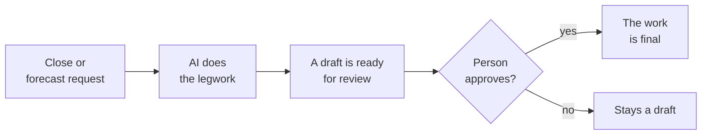
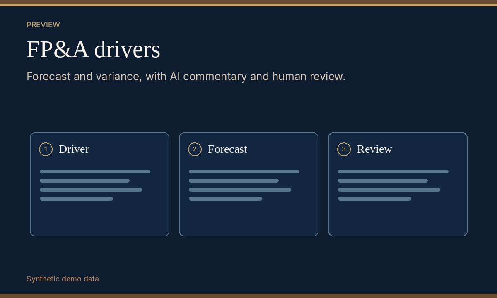
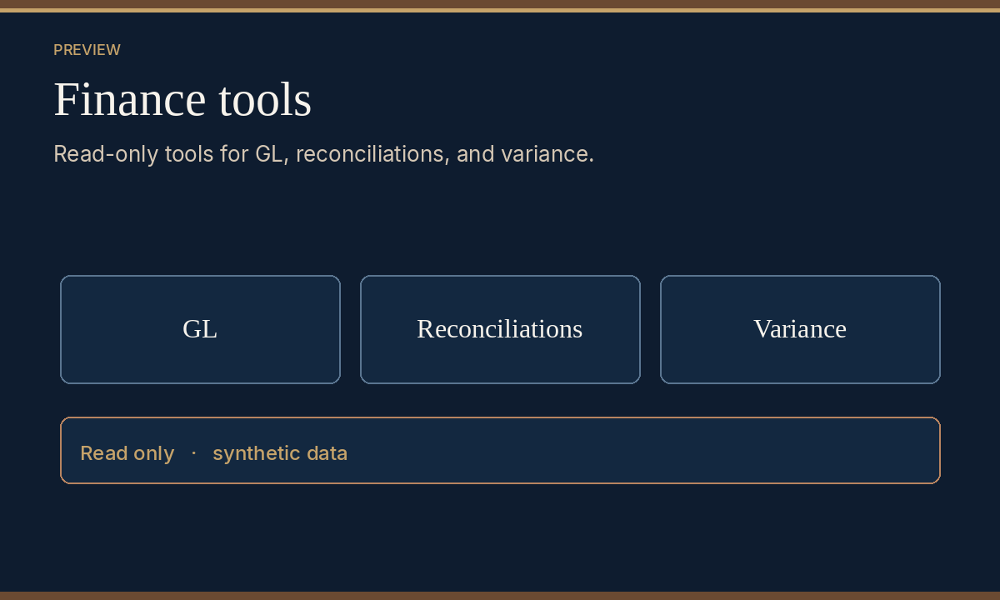

**AI does the close work, people make the call.**

I'm a finance analyst in New York, relocating, and open to Denver and remote work. I was Finance Analyst at Kane Kessler, P.C. from May 2023 to November 2026, and a volunteer tax preparer with VITA (Volunteer Income Tax Assistance) from January to April 2023.

I'm interested in FP&A and AI in finance. I build workflows where AI does the legwork and a person approves the numbers.

## ⚡ Highlights

| Result | What it means |
|---|---|
| **4 open-source demos** | [close-recon-assistant](https://github.com/tishan-perera/close-recon-assistant), [fpa-driver-model](https://github.com/tishan-perera/fpa-driver-model), [personal-ai-os-demo](https://github.com/tishan-perera/personal-ai-os-demo), and [poc.mcp-finance-tools](https://github.com/tishan-perera/poc.mcp-finance-tools). |
| **No API key** | All four run without an API key. |

<!-- TODO: verify -->
<!-- TODO: verify: education, certifications, talks, and any quantified result. -->
<!-- TODO: verify: systems and tools used in the finance analyst role. -->

## 🧭 How I build

AI prepares the work. A person approves the numbers. A yes is what makes the work final.

The four demos use synthetic or fictional data.

## 🧰 Projects

### Featured: [close-recon-assistant](https://github.com/tishan-perera/close-recon-assistant)

**AI drafts month-end reconciliations, and a person approves the numbers.** Synthetic demo data.

- Runs without an API key
- A person approves the numbers before they are final

<!-- TODO: verify: swap assets/close-recon.png for a real screenshot, and replace these lines with the steps the demo actually runs, once that repo merges. -->

 

<table>
<tr>
<td width="33%" valign="top"> <b><a href="https://github.com/tishan-perera/fpa-driver-model">fpa-driver-model</a></b> Driver-based FP&amp;A forecast and variance model with AI commentary and human review. Synthetic demo data.</td>
<td width="33%" valign="top"> <b><a href="https://github.com/tishan-perera/personal-ai-os-demo">personal-ai-os-demo</a></b> A personal AI team with a lead agent, departments, and owner approval gates. Fictional seats and demo data.</td>
<td width="33%" valign="top"> <b><a href="https://github.com/tishan-perera/poc.mcp-finance-tools">poc.mcp-finance-tools</a></b> Read-only MCP server with finance tools (GL, reconciliations, variance) over synthetic data.</td>
</tr>
</table>

<!-- TODO: verify: swap assets/fpa-driver.png, assets/personal-ai-os.png, and assets/mcp-finance.png for real screenshots once those repos merge. -->

## 🔭 What I do

* **Close reconciliations.** AI drafts the month-end reconciliation, and a person approves the numbers. Synthetic data, in [close-recon-assistant](https://github.com/tishan-perera/close-recon-assistant).
* **FP&A.** A driver-based forecast and variance model, with AI commentary and human review. Synthetic data, in [fpa-driver-model](https://github.com/tishan-perera/fpa-driver-model).
* **Read-only finance tools.** An MCP server for GL, reconciliations, and variance, over synthetic data, in [poc.mcp-finance-tools](https://github.com/tishan-perera/poc.mcp-finance-tools).
* **A personal AI team.** A lead agent, departments, and owner approval gates, on fictional seats and demo data, in [personal-ai-os-demo](https://github.com/tishan-perera/personal-ai-os-demo).

<!-- TODO: verify -->
<!-- TODO: verify: day-to-day scope of the Kane Kessler finance analyst role. -->

## 📫 Let's talk

I'm open to roles in **AI-enabled FP&A**, **finance automation**, and **financial systems**. New York, Denver, or remote.

[LinkedIn](https://www.linkedin.com/in/tishan-perera/)

<!-- TODO: verify: confirm https://www.linkedin.com/in/tishan-perera/ opens the right profile. -->
