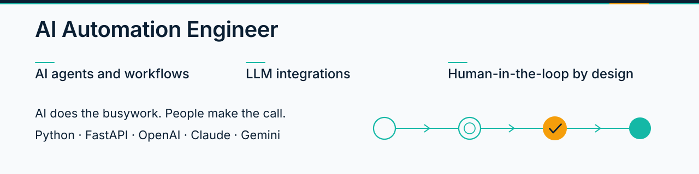

  
  

I build AI agents and workflows with a human in the loop. I'm an AI & Automation Engineer (contract, Oct 2026–present, remote) at Slicing Water. Previously I was Finance Analyst at Kane Kessler, P.C., from May 2023 to September 2026, and a volunteer tax preparer with the VITA program from January to April 2023.

I'm open to AI Automation Engineer roles — remote in the US, or hybrid in New York City or Denver. U.S. permanent resident, no sponsorship needed.

## How I build

Work arrives, an automated pass prepares it, a person approves or rejects, and only then is it done.

The project demos below use synthetic or fictional data. [personal-ai-os](https://github.com/tishan-perera/personal-ai-os) is a sanitized case study of a personal org, not a synthetic demo.

## Projects

### Featured: [ap-automation-agent](https://github.com/tishan-perera/ap-automation-agent)

**An AI-assisted accounts payable web app. It extracts and checks invoices, then a person approves, rejects, or edits every one. Synthetic data only.**

The model never invents a missing amount: an unreadable or absent total is stored as null, flagged, and sent to review. After extraction, validation, duplicate checks, 2-way and 3-way matching (tolerance: the greater of $1.00 or 1% of the PO total), and suggested GL coding are plain, tested Python. Nothing is exported until a person approves it, and every action goes to an audit log. Approved invoices can be downloaded as a QuickBooks-style CSV.

Default run uses an offline mock provider — no API key, no network. Swappable Gemini, Claude, and OpenAI providers are implemented but have not been run against live APIs. 118 tests, all on the mock; CI runs ruff and pytest on every push and pull request. A mock eval on 24 synthetic invoices is documented in the repo with this caveat: it is not a measure of real LLM accuracy.

Stack: Python, FastAPI, Jinja2, HTMX, SQLite, SQLAlchemy, Pydantic, pytest, ruff, Docker Compose. Personal project, November 2026. MIT.

### [personal-ai-os](https://github.com/tishan-perera/personal-ai-os)

A public case study of a personal multi-agent organization: a chief-of-staff agent, department seats, and owner approval before a message is sent, a job is applied for, a hire is made, or a comparable action is taken. Sanitized (no private data). The runnable fictional companion is [personal-ai-os-demo](https://github.com/tishan-perera/personal-ai-os-demo) (Atrium).

### [close-recon-assistant](https://github.com/tishan-perera/close-recon-assistant)

An assistant that drafts a month-end cash reconciliation for one fictional operating account. A person approves or rejects the open rows; approved rows stay `approved_not_posted`; nothing is posted. Rules engine, synthetic Sample Harbor LLC data, default run with no API key and no network.

### [poc.mcp-finance-tools](https://github.com/tishan-perera/poc.mcp-finance-tools)

Read-only MCP tools over synthetic books (trial balance, open reconciliations, budget variance, aging). A draft adjusting entry comes back unposted. The server never writes the ledger. No API key.

### [fpa-driver-model](https://github.com/tishan-perera/fpa-driver-model)

A driver-based forecast and budget-versus-actual model for fictional Fairhaven Metrics LLC. The variance write-up is held until an analyst approves the draft. No API key.

## Open to

I'm open to **AI Automation Engineer** roles — Remote (US) / Hybrid NYC or Denver.

[Portfolio](https://tishan-perera.github.io/) · [LinkedIn](https://www.linkedin.com/in/tishan-perera/) · [GitHub](https://github.com/tishan-perera)
